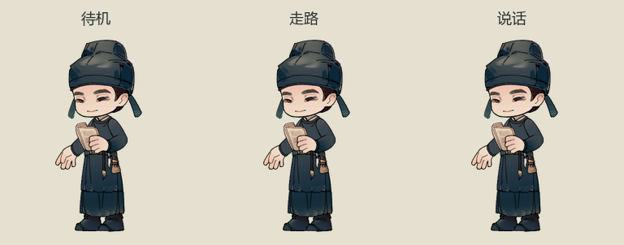
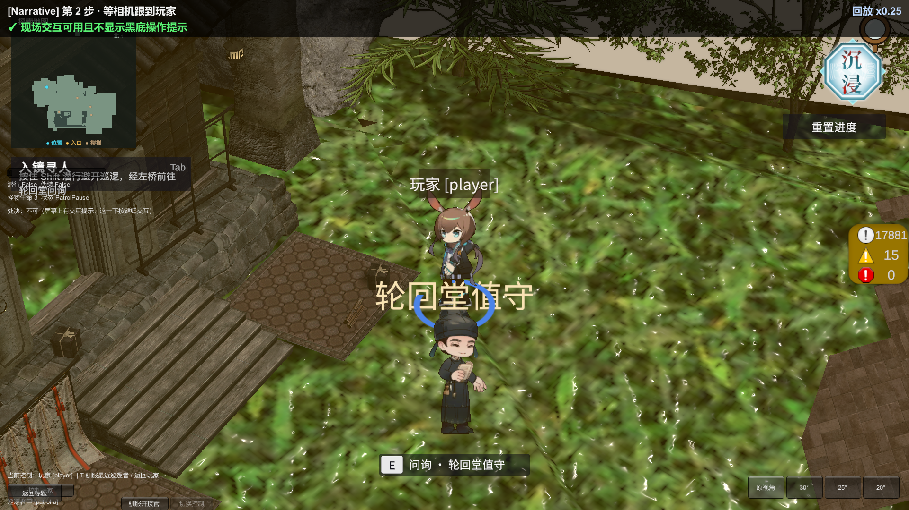
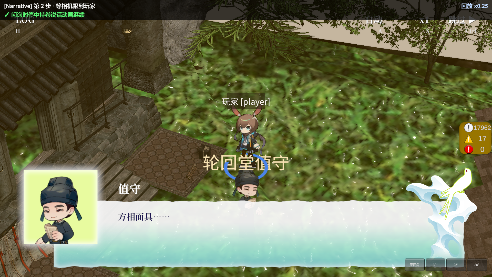
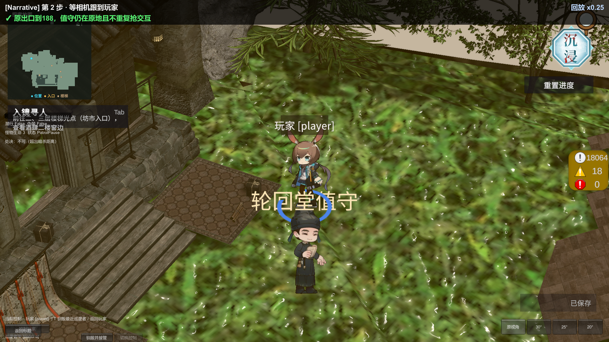

# 轮回堂值守外观接入

本批接续王录业成果，使用独立资产ID `lunhuitang_guard`；项目分别提供两套交付及不同说话人，没有把“值守”合并成王录业。

## 定位与素材

- 源目录 `Assets/_Project/Art/Sprites/Characters/lunhuitang_guard/parts/` 实查15张512×512静态RGBA PNG：头、两片帽子、脖子、上下半身、前后上下臂、两脚、纸、淡笑／说话表情。原PNG与.meta保留。
- 实际目标是SampleScene妖界SpotlightStory的 `enter_r0171`，锚点 `StoryPoint_enter_r0171`，位置(-24.5,6.95,17.7)。原Chibi_chen占位只替换视觉子物体，保留QuestLocation、标签、坐标、Point引用和原E问询。人界同编号 `MirrorCrossing` 是入镜点，保留原外观；王录业不动。
- 对应21008、21012、21013共12句“值守”，文策记录都位于轮回堂。角色源表使用 `lunhuitang_guard`，保留显示名“值守”、原文、节点和出口。导入器只在“值守”且地点含“轮回堂”时映射，另有负对照，不把其它关卡同称谓自动合并。

## 制作与接口

复用已核实的拆件→Unity剪辑采样→FramePuppetGenerator管线。保留 `Chibi_lunhuitang_guard_parts.prefab` 标定和rig源剪辑；最终 `Chibi_lunhuitang_guard.prefab` 使用120张透明整帧（Idle48、talk48、Walk24），24fps、PPU320、pivot(0.5,20/512)，默认朝左源图由flipX校正；无独立Run，沿既有Walk回退。

持卷手与纸在同一前臂关节链，帽子／帽带跟头部，衣上挂件随身体。下半身贴图原有一片位于脚上方的黑色椭圆，标定Sprite矩形仅排除这片阴影，保留袍摆和原PNG。默认／说话半身头像从同一组合导出，地址为 `Dialogue/Portrait_lunhuitang_guard_{default,talk}`。

制作入口：`Tools/build-lunhuitang-guard-animation.txt`（已有标定拒绝覆盖）、`Tools/bake-lunhuitang-guard-frames.txt`、FramePuppetGenerator.Generate；接线脚本 `Tools/bind-lunhuitang-guard.txt`。既有SpotlightSceneBindings追加演员引用；静态实例停用Motion，经已有ChibiPuppet.SetDialoguePose选Idle／talk，避免双驱动。对象显隐仍归原Display，不加入王录业的临时人物收起规则。

## 验证

Luban生成、文策导入自检及相关C# lint通过。120张透明帧、两张头像和本次资产.meta已核对；已查看持卷组合与头像。Unity刷新后实例退出，重新打开相同版本与本工程后恢复MCP；初始化阶段两次测试未实际启动（一次超时、一次域重载孤儿），不计为通过。实际场景绑定成功后实读确认：外观为Chibi_lunhuitang_guard，位置保持(-24.5,6.95,17.7)，Motion停用。

恢复后EditMode先完成336项，但退出测试后复现DialogueView姓名补间访问已销毁TMP控件（堆栈指向ApplyNamePunch）。在原回调加入Unity对象判空，并增加“姓名控件先销毁、视图仍存在、等待完整补间”的回归；不改UI样式。最终EditMode337通过、0失败、0跳过，批次 `9e847f0835d442f18d668c8ce4b1e741`，控制台零错误。

最终PlayMode合跑值守与王录业两条真实流程：2通过、0失败、0跳过，批次 `3f02ed3322544b6393fb7dfba580dba8`，耗时229.31秒。报告 `Logs/verify/narrative/20261019-194136/report.md` 含两条各40条记录、共10张截图，检查点失败0、运行时异常0。值守沿正式新游戏、教学、人间对白、入镜和步行路线抵达原交互点，以E开启21008，实测时停下说话动画继续、切崔皓时待机及头像退出、原出口推进188后值守留场且不重复抢交互。王录业同时回归21007说话／严肃、结束收起及21014取消清理。

已检查并归档本轮游戏截图：

未提交或推送；独立包、目标设备与后续完整主线不在本次实测范围。21012／21013已通过12句数据映射测试，但没有实走后续完整路线。视觉表现请你在 Game 视图 / 截图里确认，告诉我哪一步不对。
