# 聚光灯文策讨论记录与游戏机制流程

整理日期：2026 年 10 月 12 日。用途：制作方与文策核对设定、收敛本期范围、补足关卡之间的行动理由。

> 2026-10-18 归档说明：本文保留当时聊天的解释、暂定方案与问题清单，不把之后的实现反写成聊天结论；后续用户定案优先。当前范围与接入状态见 [项目交接](../../HANDOVER.md)。

两批聊天的共同方向是重点打磨阶段一，视制作能力削减后续机制，同时尽可能讲完十二阶段故事。具体删减尚未拍板。当前可以明确的是：阶段六的特殊身份与面具解决进入 BOSS 房的权限，不能跳过 BOSS；阶段一的店铺串联、面具消耗规则，以及阶段三的动态水位和世界归属仍需确认。

流程采用**剧情按阶段推进，区域内允许探索和多种解法**的读法。十二阶段大纲有先后关系；五店没有已确认的固定访问顺序，部分关口有身份、钥匙、暗杀等替代路径。这支持局部开放的判断，尚不支持主线阶段可以任意跳转。

## 阅读口径与材料

- **已明确**：聊天中明确澄清的含义或共同表达的目标，不等于已实现，也不自动等于全团队批准。
- **暂定**：文策正在考虑的新方案、口头回顾、条件分支或制作建议。
- **待确认**：存在冲突、缺少操作规则，或会影响本期范围的问题。
- **原稿设计**：仓库策划原文写到的机制；是否采用、是否进入本期仍需与聊天结论对齐。
- **工程资料记载**：现有流程地图和模块文档描述的接线状态，本次没有运行游戏验收。

聊天来源按上传顺序标记为 A1–A7、B1–B7。A 指第一批，B 指第二批；左侧按文策发言整理，右侧按制作方发言整理，不补姓名。语音内容依据截图显示的转写；截图里的 AI 分析是讨论材料，不作为团队决议。截图没有给出完整日期，不将整理日期当作聊天发生日期。

项目参照：

- [剧情大纲](../../docs/design/spotlight/01_剧情大纲.md)：十二阶段故事结果。
- [阶段一设计](../../docs/design/spotlight/02_阶段一设计文档.md)：五地点附身与小游戏方案。
- [战斗阶段设计](../../docs/design/spotlight/03_战斗阶段设计思路和怪物命名关系.md)：阶段一、三、六、九的区域、怪物与道具链。
- [回合制作战](../../docs/design/spotlight/07_回合制作战文档.md)：开战方式、怒气招式与醉酒 BOSS。
- [策划主页](../../docs/design/spotlight/00_飞书主页.md)：室外布置、音乐光点改动和本体弱小设定。
- [游戏流程与玩法地图](project-flow-map.md)：目标设计与工程接线的区别。
- [制作范围讨论清单](oct20-scope-decisions.md)：已有选择与未批准的制作建议。

本地策划转写不代表飞书实时最新版本。本记录保留版本冲突，不替文策裁定。

## 一 已明确的设定与讨论意图

| 事项 | 已明确的含义 | 边界 | 出处 |
| --- | --- | --- | --- |
| 阶段六进入权限 | 取得特殊身份或击杀特定怪物获得面具，可以通往 BOSS 房；BOSS 仍必须打，战斗产出仍要取得 | 通行方式可以不同；本期是否修改或暂缓整段战斗需另行明确 | B7 |
| 后续删改的分工 | 制作方决定保留、删除或暂缓哪些阶段与机制，文策再按重点调整稿件 | 文策没有在聊天里交付具体删减清单 | A7、B1 |
| 当前制作重点 | 重点打磨阶段一，后续允许收缩，尽可能保住完整故事 | 没有最终承诺所有原机制都在 20 号前完成；聊天中的 20 号未注明月份 | A1–A4、A7 |
| 玩法与叙事的处理 | 制作方是在询问现有流程如何连接，不是要求文策强行把所有地点串成唯一顺序 | 后续提出的串联方案仍需确认；不能把这次解释理解为所有店铺从此无须关联 | A4–A6 |

**尤其要区分三个结果：取得入口权限、完成区域目标、击败 BOSS。** 前两者不自动完成后者。阶段九原稿另有跳过钱塘君第一形态的道具，不应与阶段六“不能跳过 BOSS”混为同一规则。

## 二 暂定方案与创作方向

| 事项 | 当前提出的方案 | 尚未落定的部分 | 出处 |
| --- | --- | --- | --- |
| 阶段一串联 | 从三家或五家店各取物，拼成衣服或戏服，以特定角色伪装，递交戏班并见任务目标；同时需要钥匙与进入由头 | 取物地点、具体材料、顺序、递交对象、钥匙用途；戏班与原酒肆终点的关系 | A6、B1 |
| 阶段一原先思路 | 文策口头回顾：取得任意一家店的店头道具，可以解锁最终场地钥匙 | 原稿并未清楚写出这一通用规则；与三店面具集齐再打坊正的版本不同 | A5、原稿阶段一 |
| 高难身份捷径 | 击败坊市中的高难对象，取得高权限身份后自由进出 | 聊天转写含糊；结合原稿可能是市令，名称与取得方式仍需确认 | B2、原稿市令 |
| 面具保留 | 普通小怪、精英怪的皮或面具一次性；特定怪物、强大 BOSS 的面具永久保留 | 具体分类未标注；原稿蜃师面具明确一次性，不能直接归入所有特定怪物永久 | B2、原稿蜃师 |
| 镜子的分工 | 官府大镜子用于穿越世界；随身小镜子用于照见另一侧、获得某些东西，或短暂访问 | 小镜子能否搬物、能否进入、切换持续多久；各用途不是已统一的完整规格 | B3、B5 |
| 验堤场景 | 若保留动态水位，相关场景设在妖界；若不保留，倾向放在人间，通过镜子接触妖界内容 | 水位未正式定去留；聊天条件主要围绕验堤段，不能扩展为全游戏只有一个世界 | B3、B5、B6 |
| 第一阶段人物表达 | 妖界人物的活动和行为有烟火气、美术可以阴冷恐怖，形成反差 | 属于创作目标，需要具体人物行为和对白支撑；不能据此断言玩法会更好玩 | A6 |
| 醉酒 | 文策原本觉得不太恰当，愿意尝试补足解释 | 尚未批准保留，也未补成完整规则；不因文策说不知来源就认定原稿没有醉酒 | B5、阶段一与回合制原稿 |
| 文策人手 | 可能找一到两人协助，未找到则自己写 | 没有确认新增人手，不计入确定产能 | A7 |
| 关卡编辑器 | 制作方原本考虑制作，暂缓另聊 | 属于工具与生产流程，不是剧情设定；没有得到已制作或必须制作的结论 | B4 |

另有制作范围文档记载的选择：十二阶段主线与重点玩法、戏班先接现有四轨下落式音游而把光点后置、调查采用材料查看和前置齐备后确认。它们来自已有制作讨论，不是这十四张截图新确认的事项；身份、打造、醉酒与阶段三、六、九简化仍不能据此视为全部获批。

## 三 游戏机制分块

### 总体玩法循环

下图是对原稿机制的归纳。菱形表示玩家选择或条件判断，虚线表示尚需确认的环节。区域内行动可以反复进行；不要求每个地点都重复全套机制。

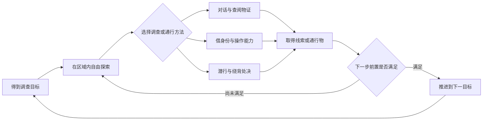

| 机制块 | 玩家做什么 | 原稿中的作用 | 当前限制或待确认 |
| --- | --- | --- | --- |
| 探索与统一交互 | 移动、观察、靠近人物或物体，选择交互 | 找线索、发现入口、判断可用对象 | 建筑内外交互需与“不做室内”的主页改动对齐 |
| 潜行与察觉 | 观察巡逻、绕开正面感知、利用背后和环境接近 | 规避敌对，创造处决或借身份的机会 | 怪物视线警戒、身份违规、关卡怀疑是不同判断，不能共用一个未定义的失败结果 |
| 暗杀与处决 | 绕背处决或使用规则、道具解决对象 | 获取皮面具，移除守门者，取得通路 | 本体弱小与可处决、可打 BOSS 如何并存；哪些对象可击杀、可刷新 |
| 附身与面具 | 操控目标或使用皮面具借身份 | 获得角色能力、对话资格与通行权 | 活体附身与掉落面具是否同一机制，退出和消耗规则未统一 |
| 身份能力 | 都知调巡逻、乐正解谜、官证改文书、金银匠打造 | 同一地点随身份改变可操作内容 | 权限与禁忌必须分别列出，不能认为高权限等于所有行为都合法 |
| 调查与文书 | 问证人、查看账册物证、比对记录 | 揭示空账、重名、断供与人变粮，改变调查目标 | 自由推理与前置齐备后确认不是同一规模；正式材料内容需文策提供 |
| 面具与关键道具 | 取得、装备、持有、合成或交付 | 连接店铺与后续阶段；提供替代通路或战斗削弱 | 一次性是在装备、过门、使用能力还是离场时消耗，尚未定义 |
| 镜子与两界 | 大镜穿越，小镜照见或短访问 | 往返调查、接触另一界线索；阶段九识破水族 | 聊天的新镜子用途不能自动继承旧版 Mirror 的耐久、镜碎与收押机制 |
| 戏班音乐 | 用正确身份处理音乐谜题 | 都知调开巡逻者，乐正完成解谜 | 五轨原稿、光点改动和现有四轨音游是不同版本 |
| 金银行打造 | 官证增加拨料，再用金银匠制作金钥匙并提交 | 身份和文书先于制作小游戏 | 本期是否保留连续点击、首饰同时提交及材料扣除，尚待确定 |
| 酒肆醉酒 | 对话选择决定灌别人或被灌 | 场外影响移动和警戒；战中影响 BOSS 行动 | 场外不可下降与战中下降 50 的关系、玩家与宿主醉酒归属、初始值和上限未统一 |
| 阶段三验堤 | 调水位、借身份过门、处理账簿追查 | 通路随水位改变，身份使用受追查；取得老吏线索与可选道具 | 动态水位去留直接影响世界归属、地图和原道具来源 |
| 阶段六仪式 | 填队列缺口、换列、借信众或执事身份 | 模仿仪式规矩，处理怀疑与追逐，进入必打 BOSS 房 | 队列、双视角、双阶段战斗各自的本期规模仍需确定 |
| 阶段九龙窟 | 选镜面、观察相邻房间、识破幻象、混入巡逻队 | 迷宫通行、抵抗周期揭露、进入龙府并对质 | 幻象复用前面机制；删前段机制就要同步改幻象内容 |
| 回合制战斗 | 战前准备，回合内用道具和怒气招式 | 关键关收束、发放后续道具 | 原稿三种开战方式与当前样例入口不等同；不自动要求所有 BOSS 都回合制 |
| 保存与失败恢复 | 保存完整结果，失败后继续或重试 | 防止重复奖励与关键道具丢失导致卡关 | 追逐失败、暴露死亡、战败的恢复点和保留状态未统一 |

### 身份与暴露的流程

本图展示两类取得途径，未把“附身活角色”和“使用面具”合并成已经定案的同一操作。普通与特殊面具的保留规则仍见问题 Q05。

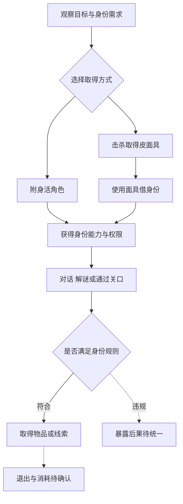

警戒值属于怪物感知；账簿属于阶段三的身份记录；怀疑度属于阶段六的仪式行为；揭露属于阶段九的周期事件。原稿分别出现死亡、追逐、召唤巡逻队等结果，需要按触发原因列规则，不能简单写“被发现就死”。

## 四 十二阶段的剧情推进关系

箭头表示大纲中的调查推进顺序，不表示区域内唯一走法，也不代表已经接成可玩全流程。序章与阶段一的教学边界尚未统一，序章不并入本图。

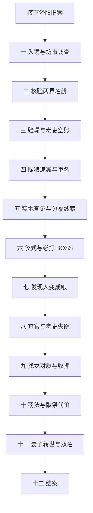

| 阶段 | 故事必须得到的结果 | 玩家行动的设计依据与待补点 |
| --- | --- | --- |
| 一 入镜 | 接案、进入坊市、找到妻子；附件版另含击败 BOSS 后获妻子位置 | 多店身份玩法有原稿；新戏服方案与终点需确认 |
| 二 名册勘察 | 轮回堂名簿与官府记录不符，改动手迹出自官府 | 核验两份记录；如何从这一发现转向验堤需补行动依据 |
| 三 验堤 | 得知水涨三尺、六万人归业簿为空账，女主帮抄录 | 老吏可互动条件与水位版本需定 |
| 四 赈粮账 | 粮逐年减少，第三年起重名，第五年断供 | 查看历年记录并确认异常 |
| 五 实地勘察 | 土质、龙牙、空白香火册、坟地异常及分福仪式 | 物证与老人证词；女主分歧是否提供选择未定 |
| 六 前往 | 参与仪式、领福肉且无人解释；战斗稿另含必打 BOSS 和空白皮 | 仪式、入口权限、战斗与领肉的具体顺序需补 |
| 七 弥勒教 | 重名不是多领粮，而是人变成粮 | 关联供粮、断供、失踪与教义；确认真相所需材料需列齐 |
| 八 找官 | 历年命官线索断在老吏，回妖界找不到他 | 查官与回访；老吏消失为何使目标转向龙族需补 |
| 九 找龙 | 对质钱塘君，得知救妻可能，确认吃龙事实并收押 | 大纲与战斗稿的对质、战斗、收押顺序未统一 |
| 十 窃法 | 秘藏卷轴说明救人需要庞大献祭 | 问乡老、找秘藏并阅读；承接阶段九的信息 |
| 十一 失人 | 妻子再次转世，其名也在那年赈粮册出现两次 | 找赵十四，再查记录，使前面线索落到寻妻线 |
| 十二 结案 | 钱塘之龙受刑关井底，不提邪教 | 大纲给定走向；没有证据支持自动追加多结局 |

非战斗调查段可以在同一区域放多个可自由查看的线索点，但段落完成应有明确证据前置。是否允许提前拿后段线索、跳过调查段或自由选择主线顺序，需另行确认。

## 五 阶段一的三个版本

### 五地点附身原稿

从坊市分别访问五地点，不把原稿“场景一到五”的编号当作强制顺序。虚线汇合点表示跨店连接尚未写清。

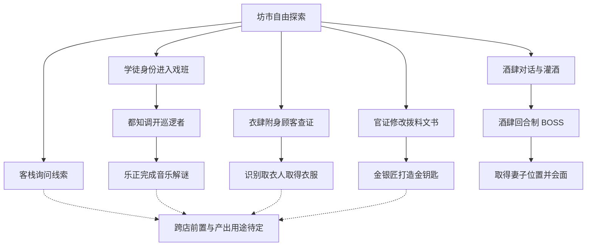

客栈是线索来源，不因编号第四就必须第四个到访。衣服、金钥匙的用途与音乐解谜奖励未写齐，不能擅自把它们全部设为酒肆硬前置。乐正能解谜却不能在解谜区被发现的规则需解释清楚。

### 三店面具与坊正原稿

三家店可以形成不同访问顺序，但原稿明确要求三个 BOSS 面具齐备才开坊正战。市令提供另一条通行路径，不自动消除酒肆内部的目标。

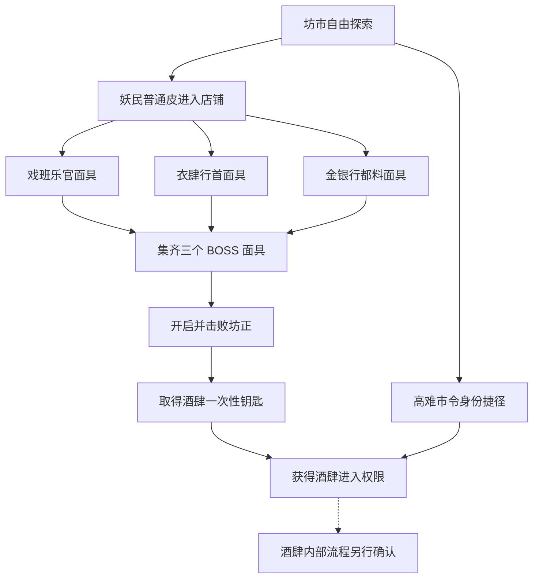

### 收集戏服的新提议

下面只表示聊天提出的共同收集目标。并未决定每家店都必做，也没有为各店编造材料名称。

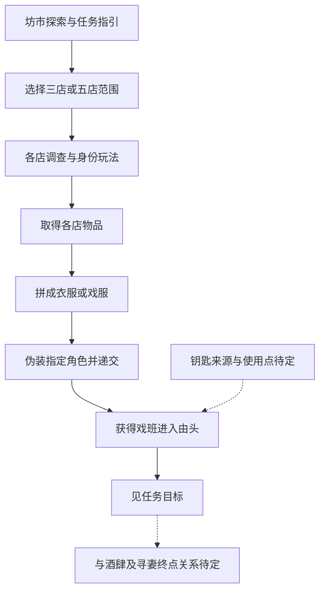

**需先确认戏班的角色：**它是阶段一最终目的地、获取酒肆线索的中间点，还是只完成某项任务？这会决定店铺任务和旧 BOSS 路线如何改，不应把三个版本直接拼在一起。

## 六 阶段三验堤机制

### 动态水位与世界归属的条件方案

这是文策提出的条件选择，尚非已批准的删减方案，也不是技术上只能如此实现。

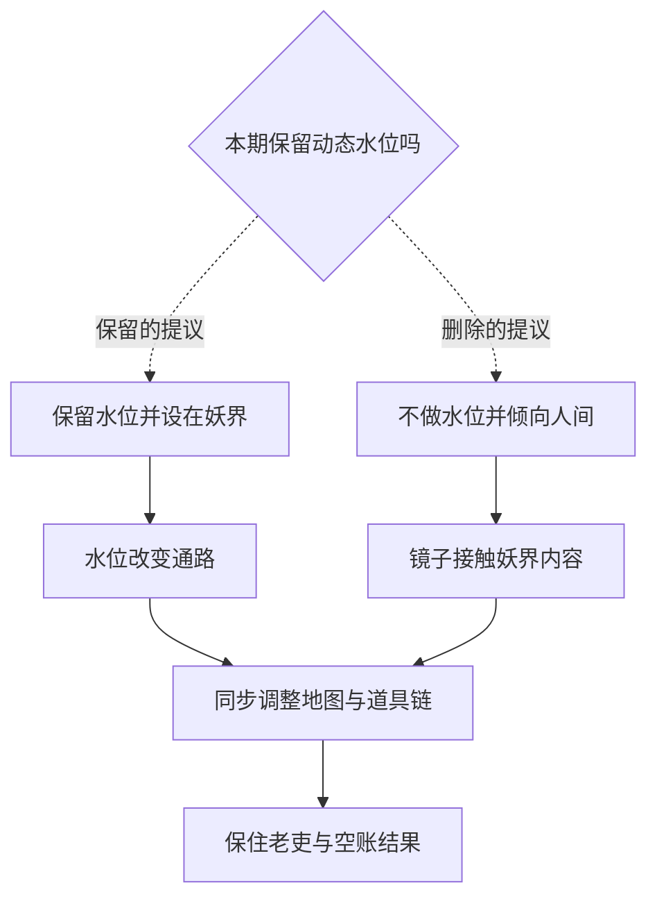

### 原稿的开放通路与支线

水口、里巷、决堤、废弃官署、抄房有区域推进关系；殁吏关口允许不同解法。账簿追查是使用身份时的风险，不是必须按下面所有分支完成的任务表。

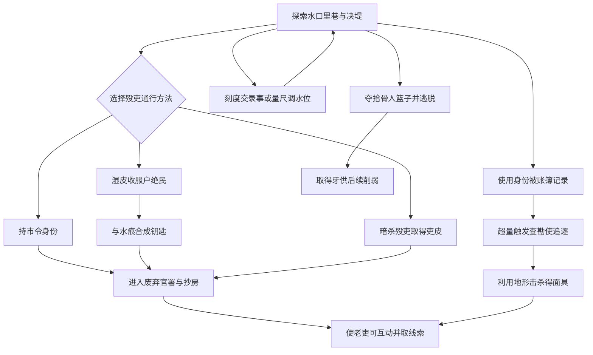

刻度与量尺是两种调水方式；图中合为一个节点，未要求全部取得。查勘使面具可使老吏进入可互动状态，并用于阶段九通行；这不证明它是唯一取得老吏线索的方法。取消水位后，湿皮刻度、水痕、量尺及对应谜题需逐项改用途或暂缓。

## 七 阶段六仪式与必打 BOSS

队列行动和通行权限是进入战斗之前的玩法。供桌阶段消耗的特定信众数量影响分福身强度；“执事皮免追逐”和“灰衣面具进房”均不跳过 BOSS。

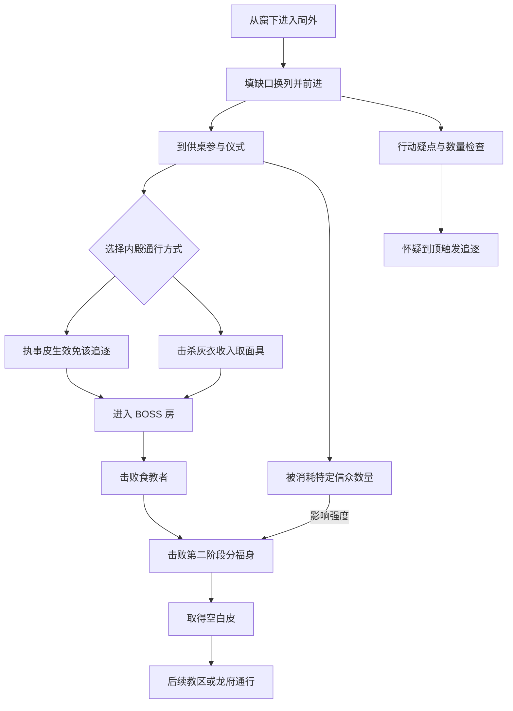

本图保留战斗稿的顺序。领受福肉与开战的关系、其他合法通路和追逐失败恢复仍待确认。附身信众后画面祥和、本体视角恐怖属于原稿提议，本期是否做双视角另定。既有范围清单推荐过非战斗替代；那只是制作建议，与此次文策解释的原设定不同，须显式决定是否修改，不能默认为已批准。

## 八 阶段九龙窟与跨阶段道具

镜面负责选择通路，身份和道具负责通行、抵抗揭露或削弱战斗。下图是机制连接，不规定每个房间必须按同一顺序处理；对质的确切插入位置仍待确认。

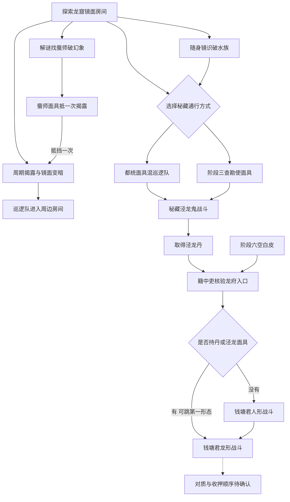

图中只画出原稿明确的通路，不把泾龙鬼设为所有玩家必打：已有空白皮能解决龙府入口。牙可削弱泾龙鬼；泾龙丹与空白皮可合成泾龙面具。蜃师“不经地图解谜破幻象就消失”的原稿措辞需核对具体触发顺序。幻象复用前三个战斗阶段的陈设与机制，因此前段删减必须同步修改幻象。

| 来源 | 产出 | 后续用途 | 是否必经 |
| --- | --- | --- | --- |
| 阶段一市令 | 高权限身份或道具 | 阶段三殁吏放行 | 替代路径，非唯一通路 |
| 阶段三湿皮与水痕 | 官署钥匙 | 殁吏通行 | 替代路径；合成消耗待定 |
| 阶段三拾骨人篮子 | 牙 | 削弱食教者、泾龙鬼 | 不把削弱物默认为必需物 |
| 阶段三查勘使 | 面具 | 老吏可互动、阶段九秘藏通行 | 是否有其他老吏交互路径待定 |
| 阶段六分福身 | 空白皮 | 教区自由通行、龙府入口、与丹合成 | 原战斗路线有明确来源；删战斗就须另改来源 |
| 阶段九蜃师 | 一次性面具 | 抵挡一次揭露或破一个房间幻象 | 原稿例外；与永久面具新分类待对齐 |
| 阶段九都统 | 面具 | 混入巡逻队 | 秘藏通行之一 |
| 阶段九泾龙鬼 | 泾龙丹 | 龙府伪装、跳过钱塘君第一形态 | 高难路线奖励，不等于跳过整个 BOSS |
| 空白皮与泾龙丹 | 泾龙面具 | 强身份能力、跳过第一形态 | 配方及扣料待定 |

阶段三的牙、阶段五剧情物证龙牙、阶段九半龙侍掉落的牙先分别登记，没有确认前不合并为同一物品。

## 九 回合制与醉酒机制

以下为 07 原稿，主要明确阶段一 BOSS，不把它自动套到所有关卡。

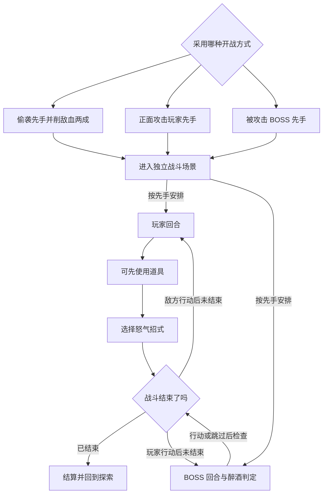

- 招式一无消耗，增加 1 怒气；招式二消耗 1 怒气并削弱对方治疗；招式三消耗 3 怒气，之后 3 次攻击有额外伤害。施放招式后交给敌方回合。
- BOSS 醉酒原稿分四档：0–49 正常；50–79 有 20% 概率跳过回合；80–99 有 40% 概率跳过；100 酩酊，写有必跳回合、醉酒值下降 50、持续 2 回合。最后一档状态与数值更新的确切先后需核定。
- 酒肆场外原稿写每次饮酒增加 10、无法下降、远离酒肆清零；玩家减速且无法静步，怪物减速并缩小警戒范围。
- 场外原稿的小怪 20、玩家 100、BOSS 100 没有明确是初始值、阈值还是上限；不能擅自用作正式配置。
- 战中 BOSS 继承场外醉酒；战中玩家无醉酒值而有状态。附身时酒究竟算主角、宿主还是双方，仍待确认。

## 十 工程资料记载的可用能力

下表用于安排接入工作。依据[现有流程地图](project-flow-map.md)与[Battle 模块指南](modules/battle/battle-module-guide.md)，不是本次游戏实测结论。

| 能力 | 工程资料记载 | 不能据此认为已完成 |
| --- | --- | --- |
| 综合试玩 | 标题新游戏或继续进入 SampleScene，可分别尝试对话、任务、开箱、潜行、处决、切控制与演出 | 阶段一正式关卡及十二阶段主线 |
| 身份与控制 | 多目标切控制、身份内核、伪装禁攻层已有不同程度接线 | 取得面具到使用能力、退出、消耗、过门的一整条链 |
| 潜行怪物 | 巡逻、警戒、追逐、击倒与处决相关能力已有 | 遮挡事实完整影响怪物感知、所有关卡规则追逐 |
| 道具与库存 | 开箱入背包、分类查看、战斗消耗品扣减 | 处决自动掉面具、通用装备使用、正式配方与跨阶段门槛 |
| 回合制 | 样例 BOSS 由剧情触发，开战、界面、结算、胜利隐藏 BOSS、击倒后可重试已有闭环 | 正式酒肆 BOSS、偷袭或被打触发、真实场外醉酒；战后玩家血量也未回写世界玩家 |
| 两界 | 人间泾阳与妖界坊市灰盒有传送点与出生点 | 标题自然进入正式两界主线、完整碰撞与世界恢复 |
| 音游 | 独立四轨 DFJK，含 Tap、Hold、校准、成绩与暂停 | 乐正权限触发、曲谱通过条件、结果影响与返回戏班 |
| 表情能力 | 捏脸与表情识别研究试玩 | 已进入角色扮演、对话核验或正式章节 |
| 叙事与调查 | 对白、任务、剧情条件、演出和线索库存已有支撑 | 正式文书与调查操作、所有十二阶段内容 |
| 保存 | 综合试玩有事件请求保存与稳定边界管理；战斗中途不按回合恢复 | 任意阶段、任意世界、任意瞬间都能可靠恢复 |

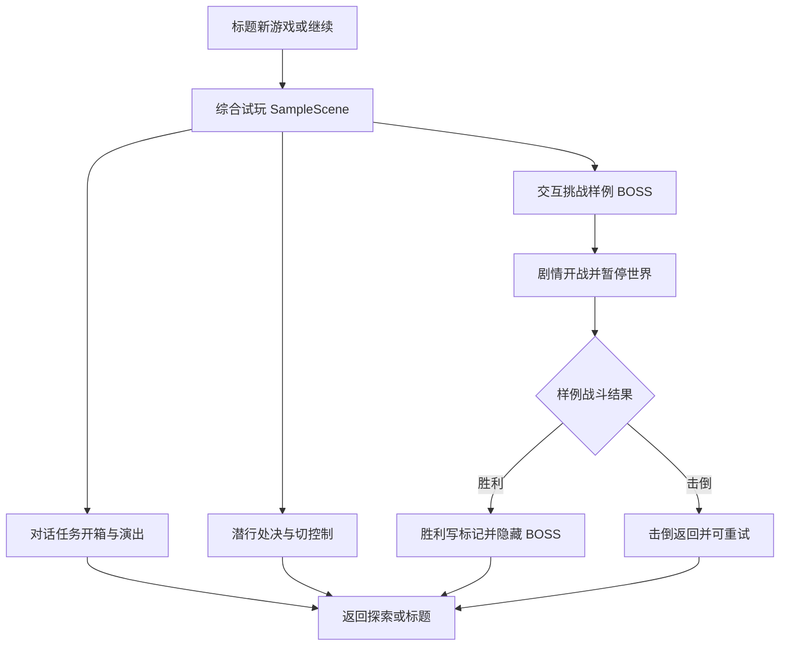

两界灰盒与独立音游另有入口，不画成标题后的自动必经流程。目标设计里的多解通路要成为实际开放玩法，还需任务前置、身份权限、道具消耗、失败补取和读档同时成立。

## 十一 需要制作方跟文策确认的问题

### 优先确认范围与主路径

| 编号 | 直接确认的问题 | 需要形成的答案 | 影响 |
| --- | --- | --- | --- |
| Q01 | 本期是完整十二阶段故事加重点玩法，还是阶段一独立演示？哪些阶段删、哪些仅简化、哪些暂缓？ | 每阶段保留的行动、故事结果与完成标准 | 总范围、文策工作量和排期 |
| Q02 | 阶段一用五地点附身、三店面具加坊正，还是收集戏服的新方案？ | 一条被认可的主路径，另列可选路径；阶段终点是什么 | 所有店铺、BOSS 与奖励 |
| Q03 | 戏服交给谁、伪装谁、进入哪里、见谁？钥匙开哪里？酒肆与寻妻仍保留吗？ | 每项产出的取得点、使用点与叙事理由 | 新方案能否接上原大纲 |
| Q04 | 五店能否自由顺序？必须完成几家？市令能绕过哪些任务、又必须保留哪些调查或战斗？ | 区域可选点、硬前置、替代解法及仍需完成的目标 | 开放程度与通关条件 |
| Q05 | 哪些皮面具一次性，哪些永久？蜃师一次性是保留的例外吗？ | 逐项名单；消耗发生时点；失败或误用后的补取 | 软锁、库存与保存 |
| Q06 | 附身活角色和使用掉落面具是一套还是两套？能控制、继承能力、继承物品的范围各是什么？ | 取得、使用、退出、宿主后果与读档行为 | 身份玩法及所有店铺 |
| Q07 | 阶段三保留动态水位吗？删后在何界，原水位物品和过门条件如何处理？ | 水位去留、世界归属、替代路线、牙与老吏线索来源 | 场景、镜子、阶段六与九 |
| Q08 | 阶段六保留哪些仪式动作和 BOSS 阶段？若因范围改成非战斗，是否明确批准修改原设定？ | 本期战斗要求；空白皮来源；领肉、入场、战斗顺序 | 阶段九通行及后续故事 |

### 再确认操作规则与叙事衔接

| 编号 | 直接确认的问题 | 需要形成的答案 | 影响 |
| --- | --- | --- | --- |
| Q09 | 阶段九是否保留完整迷宫、幻象、泾龙鬼与双形态钱塘君？ | 必经战斗与可选战斗；对质、战斗、收押顺序；跳第一形态规则 | 后段高潮、道具和美术 |
| Q10 | 大镜与随身镜分别能做什么？照见、获取物品、短暂进入是哪些实际操作？ | 触发对象、范围、持续时间、退出、需要哪些另一界空间 | 两界制作与调查 |
| Q11 | 普通察觉、身份违规、账簿超量、怀疑到顶和龙族揭露分别有什么后果？ | 每种触发、提示、化解方式、失败和恢复点；账簿与怀疑的计数及清零 | 玩家能否理解和重试 |
| Q12 | 戏班是否沿用现有四轨音游？金银行保留哪些打造动作？醉酒是否本期必做？ | 三项分别选定；若保留醉酒，明确场外与战中衔接、数值含义和身份归属 | 小游戏与正式战斗接入 |
| Q13 | 每个调查段必须看哪些材料，拿齐后如何确认结论？ | 必查证据、结论条件、回看方式；是否允许提前取得后段线索 | 非战斗段的主动玩法 |
| Q14 | 妻子与女主是否同一人？为什么从阶段一去查名册、从老吏失踪转向龙族、从对质转向窃法？ | 角色对应表；关键迁移的一条线索与下一条行动目标 | 人物、对白与跨阶段动机 |
| Q15 | 牙、龙牙、福事与福肉是否同物或不同物？本期合成、道具携带和消耗如何定义？ | 名称与物品对应表；必需物和可选增益分开；缺物替代方法 | 全程道具链 |
| Q16 | “人味儿”具体体现在哪些人物和互动？需要谁补稿？ | 各店一到两个可执行行为或对白情境；确定协作者与交稿范围 | 阶段一文策重点与产能 |

“十二阶段”“阶段一”和“第一章”先分别使用，待文策确认术语映射；不把语音中的“12”拆成新的阶段数量或误当一个阶段。

## 十二 建议的讨论顺序与结论格式

先确定 Q01–Q04 的交付范围、阶段一终点和开放程度；再确定 Q05–Q08 的身份消耗、水位与阶段六战斗；最后处理阶段九、失败、小游戏及故事动机。这个顺序是整理建议，尚非团队决议。

每个关口按下面格式记录，既能保留开放玩法，也能把完成条件写清楚：

| 区域或关口 | 玩家目的 | 必须完成的结果 | 可选解法 | 产出与下游用途 | 失败及补取 | 本期结论 |
| --- | --- | --- | --- | --- | --- | --- |
| 阶段一终点 | 待文策明确 | 待明确戏班、酒肆、寻妻的关系 | 店铺收集、市令等需定范围 | 戏服、钥匙、身份各自用途待定 | 关键物误用能否补取待定 | 未定 |
| 阶段三殁吏关口 | 前往官署与老吏 | 通过关口并取得调查线索 | 原稿有市令身份、合成钥匙、暗杀 | 老吏线索；可选牙与查勘使面具 | 水位删减后的替代条件待定 | 未定 |
| 阶段六内殿 | 接近仪式核心 | 原设定仍需击败 BOSS | 执事皮、灰衣面具等入场方式 | 空白皮通往后续区域 | 战败、领肉和奖励恢复待定 | 原义已澄清，制作规模未定 |
| 阶段九龙府 | 对质钱塘君并收押 | 故事结果与实际战斗规模需对齐 | 空白皮、泾龙丹等入口路径 | 救妻信息、收押结果 | 道具与形态重试待定 | 未定 |

开放程度应通过这些具体规则确认：可访问哪些地点、哪些产出有替代来源、哪些关口有多种解法、哪些结果仍必须取得。增加支线、多个结局或完全自由主线顺序不在当前明确范围内。
