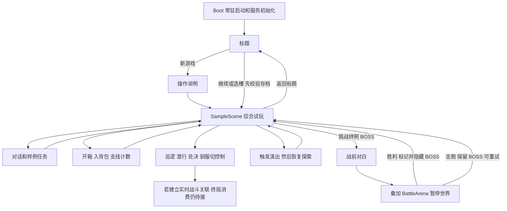

# 21Days 游戏流程与玩法地图

更新日期：2026-10-12。对象：需要把场景、剧情和玩法串起来的项目成员。

> 2026-10-18 归档说明：本文的“当前接线”“当前工作区”均指 10 月 12 日观察快照，不代表最新构建状态。正式序章、同场景两界与五店等后续接入以 [项目交接](../../HANDOVER.md) 和模块指南为准。

界面布局讨论草图：[主界面初稿](../../docs/design/wireframes/main-hud-lowfi.png)、[主界面第二稿](../../docs/design/wireframes/main-hud-lowfi-v2.png)、[右侧抽屉初稿](../../docs/design/wireframes/right-drawer-lowfi.png)、[右侧抽屉第二稿](../../docs/design/wireframes/right-drawer-lowfi-v2.png)。这些图片仅作方案参考，不代表正式界面验收。

《聚光灯》的目标体验是：**玩家往返人间与妖界调查泾阳旧案，借用身份取得权限和线索，在关键关卡处理潜行、追逐与战斗；调查逐步揭露分福仪式，也改变寻妻线的意义。** 这是依据现有策划串出的整体理解，不是已完成的可玩全流程。

工程现状是：**一个由标题进入的综合试玩场景、两张另有入口机制的世界灰盒、一个剧情驱动的样例战斗，以及音游和表情识别等独立试玩。** 各部分已有不同程度的规则和接线，但十二阶段尚未组成连续主线。

## 1 阅读口径

本文使用三种状态：

- **当前接线**：能在源码、内容表或场景引用中找到实际入口与调用。它不等于本次已经运行通过，也不等于正式美术和体验验收完成。
- **目标设计**：仓库当前《聚光灯》策划明确写到的内容；不据此宣称已经实装。
- **待定或推断**：原文有冲突、没有定义，或为了理解流程作出的归纳。没有把这些点补成确定规则。

策划基线来自本地转写，00–05 标注的拉取日期为 2026-10-06，06、07 为之后补交原件；[策划索引](../../docs/design/spotlight/README.md)还记录了新增附件同步范围。本图不代表飞书实时最新版本。工程状态以当前工作区为观察对象，包含未提交改动。

## 2 先分清阶段 地点 场景和模块

| 名称 | 在本项目里是什么 | 例子 | 最容易混淆的地方 |
| --- | --- | --- | --- |
| 剧情阶段 | 整段故事的进度单位 | 入镜、名册勘察、验堤 | 十二阶段不等于十二个 Unity 场景 |
| 地点或区域 | 玩家在哪一片空间行动 | 戏班、酒肆、水口、供桌 | 策划写“场景一戏班”不代表必须独立加载一个场景资产 |
| Unity 场景 | 实际加载的世界或试玩舞台 | SampleScene、HumanJingyang、BattleArena | 一个场景可以承载很多玩法；场景资产存在不等于关卡完成 |
| 玩法模块 | 一种职责的规则和表现 | 身份、怪物、对话、任务 | 一个设计玩法可能横跨多个模块，模块注册到 Boot 不等于内容已经接通 |
| Narrative 的 Stage | 剧情阶段机里的一个节点 | 一段对白、条件判断、等待、战斗、结束 | 策划的“阶段一”通常需要多个节点承载，不能直接当作一个代码节点 |

当前内容术语以《聚光灯》的阶段为主。旧版“章／幕／场”不能直接套过来；详细映射和未定编号见[阶段结构规范](stage-structure-spec.md)。

## 3 目标玩法怎样形成循环

### 3.1 日常调查循环

到一个地点 → 找人物或文书 → 获得证词、记录或物证 → 与已有信息比对 → 出现下一条调查目标 → 前往下一地点或另一界。

目前对话、任务目标、剧情标记、背包线索类别已有支撑；专门的卷宗、文书翻阅、推理比对界面，以及十二阶段的真实内容，不能仅凭这些基础模块推定已完成。

### 3.2 身份关卡循环

观察巡逻、守门条件与环境规则 → 选择潜行、处决、附身或借用皮面具 → 获得身份能力或通行条件 → 对话、解谜、越过关口 → 带出线索或道具 → 推动调查。

借来的身份还有反向约束：进入不符合人物特性的区域、核验失败、账簿超量、怀疑度到顶或龙族揭露，可能导致暴露。**暴露之后是死亡还是追逐，原文存在不同口径；完整失败流程尚未定型。**

“附身活角色”和“使用掉落皮面具”在设计中都承担借身份的作用，但是否属于同一机制、退出条件、宿主后果仍未统一。当前 Taming 的切换控制、Identity 的身份生效、Disguise 的伪装开关，应分别理解。

### 3.3 关卡收束与跨阶段携带

关键交互或 BOSS 收束本关 → 获得线索、面具或材料 → 这些东西改变后续通行和战斗方式 → 进入下一段调查。

因此很多机制的意义是“让调查走到下一步”。如果只按模块看，会看见一堆操作；按产出和后续用途看，才会看见关卡之间的连接。

依据：[剧情大纲](../../docs/design/spotlight/01_剧情大纲.md)、[阶段一原设计](../../docs/design/spotlight/02_阶段一设计文档.md)、[四个战斗阶段设计](../../docs/design/spotlight/03_战斗阶段设计思路和怪物命名关系.md)、[玩法功能总览](../../docs/design/features-spotlight/00_功能总览.md)。

## 4 序章与十二阶段的目标旅程

下表是目标内容地图。**整张表不是工程已实现清单。** 地点归属兼用[阶段结构规范](stage-structure-spec.md)，有冲突的地方保留提示。

| 段落 | 所在地点和世界 | 玩家行动与机制 | 得到什么以及为什么去下一段 |
| --- | --- | --- | --- |
| 序章 | 现生 → 镜子 → 里世界 | 画板列潜行、暗杀取面具、驯服附身、回答与行为扮演，最后汇到 BOSS 节点 | 介绍玩法的意图明确；与阶段一是否独立、具体教学顺序及 BOSS 机制仍未定 |
| 一 入镜 | 妖界长安坊市 | 换皮找线索；五地点方案涉及戏班、衣肆、金银行、客栈、酒肆；另有坊市暗杀方案 | 接下旧案、获得妻子位置并找到妻子；两版大纲的细节和两套关卡方案未统一 |
| 二 名册勘察 | 妖界轮回堂 → 人间官府 | 核验名簿，找王录业查询官府记录，比较文书 | 两界记录对不上，轮回堂簿册被改动且手迹来自官府，调查转向旧灾 |
| 三 验堤 | 大纲写镜中妖界；战斗设计地点写泾阳 | 水口 → 里巷 → 决堤 → 废弃官署 → 抄房；水位控制通路，使用身份记账，超量触发追逐 | 找泾阳老吏，得知水涨三尺与六万人空“归业簿”，女主开始帮忙抄录；世界归属未裁定 |
| 四 赈粮账 | 人间案卷处 | 调查历年赈粮册，比较逐年变化和重复名字 | 第三年起同名出现两次、第五年断供，带出实地核验的问题 |
| 五 实地勘察 | 人间泾阳乡间、祠堂、坟地 | 看异常土质、龙牙、空白香火册，问老人，查坟地；与女主对继续调查产生分歧 | 灾难第三年起不再新开坟地，并听到分福仪式；这些内容的具体操作和分歧是否给玩家选择未定 |
| 六 前往 | 妖界乡集祠堂，战斗设计称分福祠 | 窟下 → 祠外 → 供桌 → 内殿；填队列缺口、换列控怀疑度、附身信众改变观感，进入食教者／分福身战斗 | 领受福肉并接触仪式；战斗方案产出空白皮，可影响之后龙府通行 |
| 七 弥勒教 | 人间泾阳 | 追溯教义、供粮与断供，关联失踪者与赈粮册 | 认识到两个名字并非两份粮，而是人“成为”了粮，旧案指向官府供粮者 |
| 八 找官 | 人间官府 → 妖界 | 借王录业查历年赈灾命官，再回妖界追问老吏 | 线索断在最后一年；老吏消失，进一步转向龙族 |
| 九 找龙 | 妖界洞庭府；战斗设计另用龙窟、龙府 | 跟踪龙族、镜面迷宫、周期揭露、巡逻队、重现前面机制的幻象；对质钱塘君，战斗方案有泾龙鬼与钱塘君双形态 | 得知可能救妻的方法；证据指向钱塘龙君吃了泾川龙第二子，最后收押；对质和战斗的完整顺序未定 |
| 十 窃法 | 妖界乡集祠堂周边 | 问乡老，找开教者秘藏卷轴 | 得知从轮回带人出来需要庞大献祭，使寻妻线直接触及分福真相 |
| 十一 失人 | 妖界寻妻未果 → 人间卜算处、官府 | 找赵十四算去处，再查妻子的转世记录 | 妻子已再次转生，而且那年名字在赈粮册出现两次；前文“重复名字”的意义落到寻妻线 |
| 十二 结案 | 人间官府、井底 | 告知王录业已收押钱塘龙君，判刑关井底，不提邪教 | 大纲给出这一结案走向；是否让玩家选择隐瞒或其他结局，没有确定依据 |

正式编号一、三、六、九是四个集中承载潜行或迷宫战斗的阶段。其余阶段主要围绕调查推进；序章画板另有 BOSS 节点，不能据此断言只会有四场 BOSS，也不能把每段都规划成战斗关。

明线查旧案和寻妻线共用调查进度。这里的“双线”指内容关联，**不代表工程已有两套独立运行、可自由切换的主线系统**。

## 5 阶段一需要保留的两种流程

### 5.1 五地点附身方案

| 地点 | 进入后主要做什么 | 产出或后续用途 |
| --- | --- | --- |
| 戏班 | 学徒身份进入 → 附身都知调走音乐解谜区巡逻者 → 附身乐正解谜 | 身份决定能看到和操作什么；乐正进入解谜区被发现会暴露。明确奖励未写 |
| 衣肆 | 逐个附身顾客，通过对话判断谁真的来取衣服，再以该身份上报 | 取走衣服；裁衣匠在柜台后，原文明确无法绕背附身 |
| 金银行 | 附身官证改拨料文书 → 附身金银匠用额外金属打造 | 获得金钥匙；不是仅完成一个点击游戏，前置是身份与文书操作 |
| 客栈 | 与多名角色交谈 | 得到其他地点的线索。原文没有证明必须第四个到访 |
| 酒肆 | 附身顾客并在对话中互相灌酒，改变移动和感知，再打阶段一回合制 BOSS | 大纲把击败 BOSS 与妻子位置联系起来；酒肆外醉酒值与战中四档仍有口径冲突 |

这里只能确定**各地点内部的步骤**。戏班 → 衣肆 → 金银行 → 客栈 → 酒肆是不是强制顺序，衣服与金钥匙是否为酒肆硬前置，证据不足。

戏班音乐玩法也有三种必须区分的东西：02 原稿的五轨音游、主页改动的角色周围光点解谜、当前独立 Rhythm 的 DFJK 四轨音游。它们不能自动视为同一项已经实现的关卡。

### 5.2 坊市暗杀方案

妖民掉普通皮，使用后取得店铺入口；戏班、衣肆、金银行分别有乐官、行首、知金银行都料三个 BOSS；集齐三个面具后可挑战官署坊正，击杀取得通往酒肆的一次性钥匙。市令是另一条高难度身份通行路径，药行提供暗杀药和特殊道具。

这套方案没有写出五地点方案那套小游戏，也没有客栈；酒肆是终点，但进去以后的完整流程未展开。**目前不能把两套方案拼成定稿**，尤其不能直接把三位 BOSS 塞到五地点方案里当作必经收尾。

依据：[02 原稿](../../docs/design/spotlight/02_阶段一设计文档.md)、[03 原稿](../../docs/design/spotlight/03_战斗阶段设计思路和怪物命名关系.md)、[两套阶段一对照](../../docs/design/features-spotlight/00_功能总览.md#6两套阶段一对照)。

## 6 道具怎样把几个关卡串起来

以下是 **03 战斗阶段方案里的设计连接**，不是现在已经可玩的物品链。

| 来源 | 获得什么 | 后续解决什么问题 |
| --- | --- | --- |
| 阶段一市令 | 高权限道具或身份，原文说法未完全统一 | 阶段三殁吏可直接放行，是跨阶段通行捷径 |
| 阶段三溺者、户绝民、水痕影 | 带刻度的湿皮、收服条件、水痕 | 合成进入废弃官署的钥匙；用环境和身份取代直接硬打 |
| 阶段三录事 | 地图刻度交付，或击杀后的量尺 | 前者让录事调水位，后者让玩家自行调节一次 |
| 阶段三拾骨人 | 抢篮子并逃脱后取“牙” | 在阶段六削弱食教者，也能在阶段九削弱泾龙鬼；与剧情里的“龙牙”是否同物未定 |
| 阶段三查勘使 | 查勘使面具 | 让老吏可互动，并在阶段九通过半龙侍守门区域 |
| 阶段六供桌与特定信众 | 被消耗的特定信众数量 | 数量越多，分福身越强，关卡中的行动影响 BOSS 难度 |
| 阶段六分福身 | 空白皮 | 阶段九龙府门口可用来通行；还可与泾龙丹合成 |
| 阶段九蜃师、都统 | 蜃师面具、都统面具 | 前者挡一次揭露或破一次幻象；后者混入巡逻队 |
| 阶段九泾龙鬼 | 泾龙丹 | 龙府伪装通行，或跳过钱塘君第一形态 |
| 空白皮加泾龙丹 | 泾龙面具 | 原文说明能力较强，钱塘君战前持有也能跳过第一形态 |

是否必须携带这些道具、缺少时是否有替代路径、合成是否消耗材料，应按具体关口逐项确认。通行捷径和唯一通关条件不能混为一谈。

## 7 当前工程从哪里进 怎样玩 怎样退出

### 7.1 标题进入的综合试玩

启动代码进入标题；新游戏和继续最终都调 `MonsterEncounterState`，其地址 `IsometricEncounter` 指向 `Assets/_Project/Scenes/SampleScene.unity`。因此“开始游戏”目前展示的是综合能力样例，不是序章，也不是完成版坊市。

这张图中的分支多数是玩家可分别尝试的活动，**没有一条必须依次开箱、驯服、处决、挑战 BOSS 的正式关卡顺序**。

样例任务目前是：长者对话 → 营地 → 旅人对话两条主线；到瞭望点、开三只箱子两条支线。三只箱子分别给破旧信笺、精钢长剑、治疗药水。完成任务 1001、1002 会映射到剧情标记，供样例剧情和对白条件读取。这些人物、任务、奖励是框架样例，不能当作《聚光灯》的十二阶段内容。

依据：[启动器](../../Assets/_Project/Scripts/Core/Boot/GameBootstrap.cs)、[会话入口](../../Assets/_Project/Scripts/Runtime/Session/GameSession.cs)、[试玩场景入口](../../Assets/_Project/Scripts/Runtime/Monster/MonsterEncounterState.cs)、[任务表目录](../../Tables/Data/quest/)、[任务标记映射](../../Tables/Data/narrative_quest_flags.json)、[场景地址组](../../Assets/AddressableAssetsData/AssetGroups/Scenes.asset)。

### 7.2 样例回合制战斗的完整闭环

SampleScene 中与样例 BOSS 交互 → 播对白 1004 → 剧情停在 Battle 节点 → 战斗流程锁住世界并在黑幕下叠加加载 BattleArena → 玩家出招或使用背包消耗品 → 敌方回合 → 收场并卸载战斗场景 → 回写剧情结果 → 恢复探索。

胜利写入 `world.sampleboss.defeated` 并隐藏世界里的 BOSS；击倒进入退场出口，BOSS 仍在，可以重新挑战。**这条剧情驱动的战斗已接线**，不能继续笼统写“回合制完全没有入口或界面”。但偷袭和被攻击触发进战斗尚未接，现有入口按正面攻击、玩家先手装配；当前名册只有占位 `sample_boss`。

战斗中的玩家血量是该场配置值，战后不回写 Player 血量；外部醉酒输入也还是占位。所以它证明流程能开、能打、能回剧情，不代表正式酒肆 BOSS 已完成。

依据：[Battle 指南](modules/battle/battle-module-guide.md)、[样例战斗剧情](../../Tables/Data/narrative/sample_boss_battle.json)、[开战装配](../../Assets/_Project/Scripts/Runtime/Battle/BattleSetup.cs)。

### 7.3 两张世界灰盒的另一条流程

准备目标场景和出生点 → WorldSceneState 加载 HumanJingyang 或 YaoFangshi → 放置玩家、对准相机 → 靠近传送点，统一提示“前往” → 按交互键 → 另一张图 → 可以再回程。

两场景已有地址、出生点和成对传送点；表的 `implemented=true` 表示资产可加载，**不表示剧情、关卡机制、美术已经完成**。当前新游戏与继续仍走 SampleScene，World 回放通过显式准备转场来进入；从标题开始不能自动推定会进入人间，再进妖界。

会话的“正在游戏”条件目前只认 `MonsterEncounterState` 与活跃遭遇；WorldSceneState 不在这条条件里。因而世界路径的开局、位置恢复和自动保存不能按综合试玩路径已经具有的能力一并宣称完成。两灰盒的世界移动路径还没有完整碰撞，围墙不等于能挡住玩家。

依据：[World 指南](modules/world/world-module-guide.md)、[两场景数据](../../Tables/Data/world/scene/)、[传送点数据](../../Tables/Data/world/portal/)、[会话状态适配](../../Assets/_Project/Scripts/Runtime/Session/SessionStateAdapter.cs)。

### 7.4 独立试玩和历史内容

| 入口或内容 | 目前验证什么 | 与主线的关系 |
| --- | --- | --- |
| RhythmDemo | 三曲单谱 DFJK 四轨、Tap／Hold、校准、成绩与解锁、同局暂停 | 有外部演奏契约，但还没有正式 Boot、乐师控制、世界返回与战斗伤害的完整接入 |
| LailaRecognitionPlaytest | 捏脸输入、五类表情推理、候选模型与对照反馈 | 是研究试玩；还不能当作阶段内扮演或对话解谜的生产入口 |
| Mirror | 旧版照镜、镜裂相关 demo | 随旧策划冻结；阶段九“随身镜识破”不能自动继承旧版整套镜子机制 |
| Sample 模块 | 给开发者参考的端到端模块模板 | 与名为 SampleScene 的综合试玩场景不是同一个概念 |

独立场景存在地址也不意味着标题已提供跳转。没有用途核实依据的其它场景，不根据名字猜测它们在主线的顺序。

依据：[Rhythm 指南](modules/rhythm/rhythm-module-guide.md)、[Laila 识别模块指南](modules/lailafacerecognition/lailafacerecognition-module-guide.md)、[策划版本说明](../../docs/design/README.md)。

### 7.5 保存和退出

新游戏先看操作说明，继续不看；开箱、任务变化、对白结束、叙事变化等可以请求保存，Session 合并请求并等待稳定边界。对白中途、战斗在途等不完整状态不能视作已保存；退出时也不能绕过这些完整恢复条件。战斗中途没有逐回合存档恢复，保存到允许的战斗入口边界后再加载是从头开战。

因此需要把“某模块有存档 DTO”“某次改变会触发保存请求”“整个世界可恢复到同一现场”分开理解。当前综合试玩的保存流程已有接线，世界场景恢复还有明确缺口。

依据：[Session 指南](modules/session/session-module-guide.md)、[Narrative 指南](modules/narrative/narrative-module-guide.md)、[Battle 指南](modules/battle/battle-module-guide.md)。

## 8 每组模块在玩家流程里负责什么

| 玩家问题 | 对应模块 | 当前到哪一步 |
| --- | --- | --- |
| 我在哪 能往哪走 | World、IsometricExploration | 试玩舞台和两界灰盒；转场、出生点、相机边界已有机制，正式入口和完整世界碰撞待接 |
| 我能动什么 怎么被发现 | Player、Monster、Stealth | 行走、潜行、巡逻警戒、追击、击倒与处决相关接线；房间规则和脚本化追逐等尚未构成正式关卡 |
| 我现在是谁 能控制谁 | Taming、Identity、Disguise | 多目标驯服切控制、身份内核和禁攻层；获取身份、角色特性解谜、暴露后果与完整使用链未闭环 |
| 我现在该做什么 | Quest | 样例主支线、目标推进、追踪和已完成列表；十二阶段实际任务没有据此完成 |
| 故事现在走到哪 | Narrative | 阶段机、条件、标记、局部遭遇、稳定保存，以及回合制结果回写；当前表以 sample 样例为主 |
| 我要听谁说 看什么表演 | Dialogue、Performance | 对白、条件选项、历史与演出插播、场景演出；正式台词和关卡演出需内容输入 |
| 我得到了什么 能怎样用 | Loot、Inventory | 开箱入背包、分类查看和战斗道具扣减；怪物死亡掉落、一般物品使用与合成只有入口或纯规则，尚无完整调用链 |
| 我要怎样打 BOSS | TurnBased、Battle | TurnBased 管规则，Battle 管开战、舞台、界面和收场；样例正面战闭环，不覆盖所有设计里的 BOSS |
| 我何时玩小游戏 | Rhythm、LailaFace、LailaFaceRecognition | 已有独立音游和研究能力，正式关卡的触发、权限和结果消费需另接 |
| 我如何开始 保存和继续 | Session、Core Flow／Save／UI | 标题与综合试玩会话；World 场景生命周期的衔接尚不完整 |
| 画面上的角色怎样表现 | CharacterPuppet | 待机走路、朝向和交互表现等共用角色层；它不是独立关卡玩法 |

Core 的配置、资源、输入、暂停、音频、遥测与回放等是上述玩法的支撑。把它们当基础设施看，可以避免把“已有很多服务”误计为“已有很多完整关卡”。

## 9 目前最影响整体连贯性的断口

| 断口 | 已有的两端 | 中间缺什么以及玩家会感受到什么 |
| --- | --- | --- |
| 标题到两界主世界 | Session 标题入口、World 两图 | 当前仍进 SampleScene；不能自然开始人间与妖界的正式旅程 |
| 身份获得到身份能力 | 驯服切控制、Identity 定义与状态 | 附身与皮面具语义、背包使用、权限和角色特性玩法没有形成一条完整操作链；`AdvanceIdentity` 尚无运行调用方 |
| 处决到奖励和剧情 | 可达的按键处决、Loot 怪物奖励接口 | `SettleMonsterDrop` 未找到运行调用方；`StartBattle` 与 `ConsumeResult` 都没有运行调用方，当前试玩未建立这层实时战斗关联。只有另行建立关联后，未消费的终局才会冻结 tick。不能把处决视作会自动给皮、推进故事 |
| 遮挡事实到怪物 AI | Stealth 视线几何、Monster 感知 | 遮挡能产出 hidden／cover 事实，但 Monster 的 Sense 仍按距离和方向判断，没有使用遮挡结果；“判定隐藏”不保证怪物停止察觉或追击 |
| 背包到通行和合成 | 皮面具等类别、使用与合成纯规则 | 缺真实使用按钮、配方内容、扣料加物和世界效果消费；跨阶段道具链不能从当前背包直接走通 |
| 单点机制到正式关卡 | 身份、潜行、战斗等内核 | 水位、队列、身份账簿、周期揭露、幻象还没有构成原设计完整关卡；有枚举和事实键不等于有玩家入口 |
| 调查素材到推理过程 | 对话、任务、线索库存 | 正式文书、卷宗和比对操作缺乏完整可玩流程，非战斗阶段的具体行为仍需定义 |
| 独立试玩到剧情 | Rhythm、Laila 研究试玩 | 正式身份权限、场景触发、结果影响和返回位置未完全接入 |
| 样例进度到十二阶段 | Narrative 图、Quest 和 Session | 真实故事内容、关口条件、失败恢复与阶段收束没有配置成整条主线 |

前三类源码事实可在[会话入口](../../Assets/_Project/Scripts/Runtime/Session/GameSession.cs)、[身份规则](../../Assets/_Project/Scripts/Runtime/Identity/IdentityRules.cs)、[掉落服务](../../Assets/_Project/Scripts/Runtime/Loot/LootService.cs)、[遭遇驱动](../../Assets/_Project/Scripts/Runtime/Monster/EncounterStep.cs)核对；遮挡边界见[怪物感知](../../Assets/_Project/Scripts/Runtime/Monster/MonsterRules.cs)与[Stealth 指南](modules/stealth/stealth-module-guide.md)。

“串不起来”至少有两类原因：阅读时把策划、机制原型和试玩入口放到了同一层；工程本身也确实缺少把这些能力串成关卡的环节。现有证据支持这个判断，不能只归因为阅读方式或文档数量。

## 10 用什么方式持续看清项目

### 10.1 先沿一段玩家旅程查看

建议第一遍看标题 → 长者 → 营地 → 旅人 → 三箱子与背包 → 样例 BOSS → 返回标题和继续。目的是理解“目标、交互、奖励、结果、恢复”如何连接。第二遍单独看巡逻、驯服和处决；第三遍看两界 World 灰盒；最后看 Rhythm 和 Laila 独立试玩。这是理解项目的查看顺序，不是新增的正式关卡流程。

### 10.2 后续每个地点只需要一张关卡说明

建议按下面六项组织内容讨论：

1. 玩家带着什么目标、身份和道具进入。
2. 场上人物、巡逻、交互物和出入口有哪些。
3. 必须亲手完成什么，哪些是可选捷径。
4. 做错后触发什么，怎样恢复。
5. 带出哪些线索、道具和状态。
6. 下一地点用什么条件接住这些产出。

先用这六项走通阶段一的一个地点，再扩到整个阶段和跨阶段携带，会比继续按模块新增清单更容易检验连贯性。这是整理与验收方式的建议，不是替策划确定玩法。

### 10.3 总览只保留连接 指向既有真源

本图用于回答“前后怎么连接”。数值、接口与操作细节继续归原有[模块目录](catalog.md)、[当前策划](../../docs/design/README.md)和对应 PRP。后续变化只需要更新实际入口、产出接收方和断口状态，不复制所有模块规则，也不另建一套完成率统计。

已知旧状态冲突包括：`docs/modules/README.md` 与 HANDOVER 部分段落仍称回合制入口和 UI 未接；阶段结构规范的较早能力表仍有 Battle 被拒的记录。当前 Battle 指南、Boot 引用和 sample_boss_battle 表已提供相反证据，本文按当前接线描述。旧记录未在本次一并改写。

本文是流程核对快照，不是本次 Unity 测试或真人体验验收报告。未重跑历史测试，不将文档中的历史通过数拼成当前全项目通过结论。

## 11 沿现有关卡图串起一圈白盒玩法

本节为 2026-10-12 的关卡串联建议，回应“先不等主线剧情，把现有机制串成完整可玩流程”。地点布局取自已有图，步骤编号、访问顺序、巡逻目标与奖励关系是本次建议，**不是原策划已确定的关卡顺序，也不是当前场景已经按此接好**。

### 11.1 原图给出的空间基础

坊市街面一侧从左到右是戏班、衣肆、金银行、客栈、酒肆，右侧是乡集祠堂；建筑前是角色可移动范围，街面边缘规划遮挡物。街面通过楼梯连到过渡平台 2.5 层，平台分别连接轮回堂 3 层与洞庭府 2 层。原文要求不做室内，角色和交互放建筑门口。

人间图采用相近的街面和楼梯关系，上方对应官府和井底，街面右侧为民间祠堂。**首圈建议只使用坊市街面**，人间和上层区域保留为后续连接点；这不会妨碍本圈从接目标到交付完整结束。

原图说明：它是地点关系图，没有可用于精确施工的比例尺、碰撞尺寸、巡逻坐标或掩体视线参数。本次绘图沿用相对布局，不把图上像素当 Unity 世界坐标。

### 11.2 建议的八步关卡

| 步骤 | 原图位置 | 玩家亲手做什么 | 向下一步交付什么 | 已有与待接 |
| --- | --- | --- | --- | --- |
| 1 接目标 | 客栈门口及前方街面 | 从安全出生点进入，与 NPC 交互，接“取得通行凭证并解决酒肆目标”的临时任务 | 当前目标与地图指引 | 对白、任务和提示已有；需白盒任务数据、地点锚点和入口接线 |
| 2 潜行取面具 | 戏班前的街面掩体区 | 避开巡逻甲的视野，绕到背后按 F 处决 | 白盒通行面具进入库存，甲死亡记录，任务完成 | 绕背处决已有；需遮挡影响实际 AI、成功掉落、按稳定角色 ID 防重复及保存请求 |
| 3 验证身份 | 戏班门口 | 打开背包，装备面具；向门口 NPC 核验身份 | 本体的身份生效与戏班关口已通过 | Identity 状态和对白条件源已有；需道具到身份映射、装备入口、关口读取具体权限和当前身份反馈 |
| 4 验证控制 | 戏班露天区及门前岗位 | 只允许驯服协作目标乙，操控它到指定岗位，再切回本体 | 乙到岗及已回本体的任务进度，开放下一目标 | 切控制、移动和相机已有；需乙的限定资格、到岗判定、返回确认，不能用本体的到达地点判定冒充乙到岗 |
| 5 取得线索 | 衣肆门口 | 以已取得的身份和前置进度与顾客交互，完成最小条件对白 | 一条关于金银行的线索，下一目标 | 条件对白可复用；首圈只验身份条件和结果连接，不宣称已完成原设计的多顾客推理 |
| 6 拿到钥匙 | 金银行门口 | 线索成立后打开一只白盒物资箱，拿通行钥匙和一份战斗补给 | 钥匙在库存，酒肆挑战资格成立 | 箱子、入背包和消耗品已有；需前置条件、奖励数据和酒肆权限读取。原设计的打造小游戏暂不纳入 |
| 7 解决目标 | 酒肆门口及 BattleArena | 满足前置后挑战样例 BOSS；打输可再挑战，胜利回到街面 | 持久胜利标记，BOSS 退场，交付目标开放 | 回合制开战、舞台、胜利回写已有；需挑战前置、任务桥接和恢复检查。醉酒仍占位，不称为完整酒肆机制 |
| 8 交付并结束 | 回到客栈门口 | 向起点 NPC 交付；显示本圈完成，可以返回标题或重开 | 完成状态与可恢复存档 | 对白、通知、返回标题已有；需完成条件、最终保存与重开清理；上层楼梯不作为本圈必经出口 |

八步的目的分别是目标引导、潜行解决对象、奖励取得、身份通行、控制另一角色、线索推动道具取得、战斗收束和交付。上层区域及乡集祠堂不需要为了“地图画出来了”就全部塞进首圈。

### 11.3 白盒内容的最小约定

- **面具采用持有型装备**：取得后可以反复装备与退出，首圈不消耗、不限时。这样返回本体、失败重试都不会因为一件面具用完而锁死。它是白盒约定，不是所有面具的定稿。现有 `ItemUseSpec` 默认是一次消耗型，不能把 `consumeCount=0` 当合法装备规格硬塞进去。
- **甲与乙职责分开**：甲是处决目标，乙是协作控制目标。甲不能被当前无条件 T 键提前驯服；乙不进入本圈处决目标列表。当前额外巡逻者由同一套种类配置复制，不能靠角色外观或名字假设资格已分开。
- **操控乙与本体戴面具分开**：本圈不把切控制自动解释成继承乙的全部身份能力。控制乙时只做移动到岗；对白、开箱、装备、处决均要求切回本体，避免现有交互锚点仍取本体造成远程操作。
- **关口先约束交互资格**：没有权限就不能取得线索或挑战 BOSS，并明确提示原因。是否让玩家物理穿过门口是另一项场景碰撞接线；只关画面中的门或藏 NPC，不能等同于真正阻挡路线。
- **不把所有敌对都当死亡**：普通发现先按现有警戒、追击和击倒表现处理；错误身份只拒绝关口。账簿超量、怀疑度惩罚和周期揭露暂不强制纳入首圈。

### 11.4 最少需要补的接线

| 接线 | 具体缺口与建议落点 | 首圈验收结果 |
| --- | --- | --- |
| 白盒场景入口与任务集合 | 沿已有 SampleScene 遭遇模板、碰撞与 Session 路径制作坊市街面白盒。不要仅把入口换成 YaoFangshi 就当怪物、处决和存档也会迁移；WorldSceneDriver 当前只推玩家。白盒任务必须与原有 1001、1002 主线隔离或明确接在其后，不能新增一条无前置主线让它被旧任务排序挡住 | 标题可进入正确舞台，显示正确首个目标，完成后可退出 |
| 遮挡进入实际感知 | 把同一份场景遮挡几何交给真正驱动各巡逻者的感知路径；当前在 EncounterStep 的后置判定中写 hidden，不会逆转已经推进的 AI。主巡逻与额外目标都需覆盖 | 掩体切断视线时不会继续累计察觉，绕过掩体后恢复正常察觉 |
| 处决产出奖励 | 成功结算甲后，用稳定角色 ID 记录一次性奖励，再经 Loot 的公开入口入库存并上报任务。当前 `yao/3.json` 的 `drop_items` 为空，既缺调用，也缺实际奖励数据；不能只订阅一个事件就认为会掉面具 | 一次成功只得一件面具，重复按键、重载和重试不会刷奖励 |
| 装备面具与身份通行 | 背包选中面具后提供“装备／退出”；核对库存与映射定义，再调用 IdentityRules 借入／退出。增加白盒身份与通行权限；当前只有都统、执事皮两个占位定义。关口用当前生效身份和具体权限判定，不能只看旧伪装布尔 | 本体被拒，合法装备后通过；未知物品／身份不会扣物或误放行 |
| 驯服资格与到岗结果 | 当前 TamingRules.TryTame 只判断目标可用、双方存活，未限定距离、阶段或岗位角色。为本圈指定乙的资格与范围；控制乙到岗按乙模型位置上报 Counter，回本体再完成后续目标 | 隔街按 T 不能远程借乙；甲不能被驯服绕过处决；本体站岗不会冒充乙成功 |
| 当前阶段与物件权限 | 任务只累计当前目标，提前完成未来动作可能造成“目标已死、任务却没计”的软锁。关键动作要检查当前阶段；读档后由持久完成状态恢复门、箱、甲、乙和 NPC 权限。NPC点击、键盘和提示按钮都走同一门槛 | 提前访问有原因提示，绕行和重复交互不会跳步或卡死 |
| BOSS 前置与胜利任务 | 给现有 sample_boss 交互规则补“前置已完成＋钥匙有效”等条件；其胜利标记和终局出口桥接到白盒任务。继续沿 Battle 的三项请求身份回写，不把处决承载的 BattleSettlement 随便交给同一个 BOSS 结果口 | 无钥匙不开战；胜利只推进一次；击倒不误记成功并允许重打 |
| 身份存档与新局重置 | 已有 IdentitySaveData 和 Capture／Restore 方法，但未找到运行层生命周期调用；IdentityInstaller 仅注册纯状态。会话侧需在允许保存时抓取身份、读档时恢复、新游戏时清掉上一局身份／账簿／怀疑度 | 同进程换槽和重开不会串身份；面具库存、身份效果与关口状态能一致恢复 |
| 失败恢复与一次性状态 | 当前镜碎重入会 Begin 复活巡逻者，却保留任务和库存。需明确本圈采用“读取最近完整可恢复保存”的方式，或完整按已完成状态重建；建议首圈采用前者。沿用已有停止遭遇、关输入、失败页、重入的时序；只保留一个失败处理者，恢复时不能被离场自动保存覆盖旧正常状态 | 失败后可重试；已取奖励与死亡目标一致；无复制面具、死角色卡关或坏档覆盖 |
| 处决输入的暂停让位 | ExecutionInteractor 自己复制并启用 Execute 动作，HandleExecuteKey 仅检查交互焦点，未检查总 Gameplay 图、世界暂停／面板状态。需与对白、背包、演出、战斗的暂停门闸一致 | 在暂停、对白、背包、演出和 BOSS 战中按 F 不会处决街面目标 |

**实时遭遇结果的条件边界**：当前运行代码没有调用 EncounterStep.StartBattle，普通试玩的 EncounterId 为 0。处决会承载 BattleSettlement，但不因此必然产生 PendingResult，也不因此必然冻结。首圈的普通巡逻处决可以走“目标死亡 → 奖励 → 任务”，不必为了推进任务强行进入 Narrative 的 Battle 阶段。以后若引入实时战斗关联，才要同步补结果消费和终局后的恢复。

**面具的时限并非本圈必接项**：采用无限时装备后不需要凭空增加到期玩法；若要给面具加时限或给退出加非零冷却，才必须把 AdvanceIdentity 接入一个唯一的推进者，否则计时不会走。

### 11.5 哪些状态作准

任务进度和顺序归 Quest，交互仅上报成功事实；NPC对白、BOSS入口和收场归 Narrative；物品数量归 Loot；当前身份、账簿和怀疑度归 Identity；角色生命与控制归 Encounter／Taming；落盘归 Session。白盒接线只连接这些公开口，不另外维护一份同样的通关阶段列表。

关键物件的“奖励已发”“目标已处理”需要稳定 ID 和持久判据。可以复用已有 SceneStateScope／WorldSaveData 的按场景记实体能力，但须显式绑定到白盒路径；它不是装了 WorldInstaller 就会自动覆盖 SampleScene。掉落入库存、完成判据和任务上报应先一起落实再发保存请求，不能从中间状态恢复成“敌人死了，面具却没有”。

本圈结束保持两个不同状态：BOSS 已击败，以及客栈已交付。打赢后退出再进，应回到待交付状态，不重开 BOSS；交付后重复对话只显示完成，不再发奖励。

### 11.6 建议接线顺序与验收

先接 **处决 → 掉落 → 装备 → 核验 → 衣肆线索 → 金银行箱子 → BOSS → 客栈交付**，验证机制产出确实被下一步消费，再插入戏班的 **控制乙到岗 → 回本体**。同时处理输入让位、一次性奖励和失败恢复，不能把它们留到所谓“流程跑通之后”。

完整关卡至少要独立验这几类路径：

1. 从标题用真实按键走完八步，BOSS收场后世界、相机、HUD、输入都恢复，交付后回标题。
2. 绕路提前到衣肆、金银行或酒肆，以及错误身份、远程驯服、对甲按 T，均不能跳步，也能得到明确提示。
3. 处决、装备、开箱、胜利、交付分别重复触发；重载后也不重复奖励、不重复成功。
4. 在取得面具、控制乙、拿钥匙、打赢未交付等边界退出继续，任务、物品、身份和人物状态一致。
5. 潜行失败、玩家死亡、BOSS失败和开战异常都能回到可操作状态；原有镜碎处理不会与新恢复同时跑。
6. 白盒结束后新游戏、换槽，不继承上一局身份与完成状态；期间所有面板和暂停状态下按 F 不影响世界目标。

现有 Showcase 多为按模块独立验证；本圈需要追加一条真实玩家路径的端到端回放及上述关键负对照。处决和回合制不都在确定性回放内，不能用输入回放哈希通过代替实际 UI／场景流程验收。

首圈暂不接人间往返、上层地图、水位、队列、幻象、打造小游戏、独立音游和表情识别。它们各有额外场景或结果消费条件；先让街面这一圈完整，再决定加入哪一项能改变关卡行为。

核对入口：[原图所在策划主页](../../docs/design/spotlight/00_飞书主页.md)、[遭遇驱动](../../Assets/_Project/Scripts/Runtime/Monster/EncounterStep.cs)、[处决按键](../../Assets/_Project/Scripts/Runtime/Stealth/ExecutionInteractor.cs)、[控制规则](../../Assets/_Project/Scripts/Runtime/Taming/TamingRules.cs)、[身份注册](../../Assets/_Project/Scripts/Runtime/Identity/IdentityInstaller.cs)、[会话状态](../../Assets/_Project/Scripts/Runtime/Session/SessionStateAdapter.cs)、[镜碎重入](../../Assets/_Project/Scripts/Runtime/Mirror/MirrorCrackPresenter.cs)、[当前 BOSS 交互规则](../../Tables/Data/narrative_encounters.json)。
