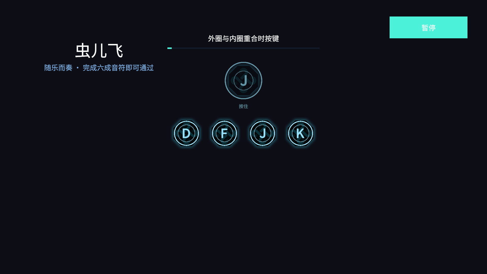

# QTE 八角键帽美术置入（2026-10-20）

本批仅调整节拍提示的表现。音频、谱面、判定窗口、长按规则、时钟和通过比例沿用现有 QTE。

## 素材与样式依据

| 交付源（归档相对路径） | 用途与目标 | 依据 |
| --- | --- | --- |
| `rhythm-qte-art-20261020/source/qte-keycap-original.png` | `Art/Sprites/UI/Rhythm/Delivery20261020/qte-keycap.png` → `RhythmQtePrompt/Face/Keycap` | 用户指定键底；原始 154×154 RGBA；不烘焙文字 |
| `rhythm-qte-art-20261020/source/font-color-reference.png` | `RhythmQtePrompt/Face/PromptKey` 的可编辑 TMP 样式 | Photoshop 示例标注 Source Han Sans CN Bold、78 px、#97E2F8；截图缩放不代表运行字号 |

键帽原图 SHA-256：`dc6feeac8f59735e336a05fe1e71db9c35291b406acbdbb01c9375e0592f167e`。四角 alpha 为 0；半透明青色光晕延伸至边界。alpha≥128 的实体范围为 x/y 16…137，中心均为 76.5；不透明白边不存在，不裁掉原图光晕。保留中心 pivot、原始比例、透明度与清晰度。

项目已授权字体中只有 SourceHanSansCN Regular，没有同族 Bold。使用现有 Regular SDF 加 TMP Bold 是字重近似，不能宣称与设计源 Bold 等同；不改用衬线 Bold，也不下载字体。主字颜色使用 RGB(151,226,248)，不加描边或阴影，不把 F 固定偏移推广到其他字符。采用 TMP `MidlineGeoAligned`：已核实工程 TMP 3.0.7 的实现按文字 mesh extents 与行可见 extents 居中。验证读取 `characterInfo` 中可见字符顶点的并集，再从截图取青色字形像素边界，不用包含行度量的 `textBounds` 充当可见边界。

## 三版文字动效方案

时长为设计建议；判定始终使用既有歌曲时钟，动画不参与判定。

| 方案 | 触发、焦点与时间 | 重复、暂停与成本 |
| --- | --- | --- |
| A 稳定合圈（采用） | 提示出现即显示居中字，不平移、不缩放、不延后；主组 alpha=1、下一组=0.4；外圈沿原 approach 时间收向内圈；结算时键字停止显示，键帽与圈沿原 180ms 时长在同一中心淡出，中文字反馈维持原时长。无悬停，按键只触发既有命中反馈。 | 重试清空旧淡出；关闭隐藏全部键帽；暂停冻结歌曲时刻与淡出；文字只在绑定或轮次变化时更新，环形 mesh 继续既有刷新。适合高频节拍，不改变读键时机。 |
| B 轻弹落定（未实现） | 提示出现后主体 120ms 从 0.96 到 1，以 EaseOutQuad 回稳；主字与键帽同时，无错峰；后续合圈与停留同 A；命中 60ms 收缩至 0.98、80ms 回稳，180ms 淡出。无悬停。 | 重复触发取消并复位，暂停冻结，关闭复位；需增加缩放更新与短动效生命周期；连续提示可能影响字形稳定性。 |
| C 两拍显字（未实现） | 键帽 160ms 淡入，主字延后 40ms、100ms 淡入，EaseOutSine；不移动；之后保持至结算，180ms 退场。无悬停，按键沿既有反馈。 | 重复/关闭取消并还原，暂停冻结；需增加分段透明度更新；短预告窗口会压缩实际读键时间，因此本批不采用。 |

A 与八角暗纹、青色静态字的参考一致，并保留现有时间参数；不增加三套切换系统或持续文字弹跳。

## 接线与验证状态

- 原图已归档并保持字节一致；Unity 导入后为 154×154、中心 pivot、FullRect、Bilinear、Uncompressed、alphaIsTransparency=true、mipmap=false。
- 已绑定：`RhythmDemoBuilder` 维护独立提示 Prefab，`RhythmView` 实例化并缓存节点；`RhythmState` 提供实际运行的 InputActionAsset，由现有 `InputBindingDisplay` 读取显示文本。`ApplyQtePromptArt` 保留已有提示 Prefab 的手工编辑，仅重接面板引用；重建场景复用该入口。无需为子 Prefab 另建 Addressables key。
- 方形 Face 复用 UGUI AspectRatioFitter，键帽在其中保留比例；环形在完整方形区域绘制，不用八角 Mask。主键与长按说明独立；下一组整体透明度 0.4。结算的 180ms 淡出留在原提示中心，取消旧底部小条闪光。
- 代码仅在轮次、绑定或设备变化时写键字；布局锚点相同即跳过写入。未增加子 Canvas、LayoutGroup、材质实例、每帧节点查找或像素采样；像素扫描和强制 mesh 更新只在测试中使用。
- 提示 Prefab 位于 `Assets/_Project/Prefabs/UI/Rhythm/RhythmQtePrompt.prefab`；它是面板依赖的子部件，不是 `UIService.OpenAsync` 独立面板。重新执行 `21Days/音游/应用八角提示美术` 后已读回正确引用和字体／颜色／绘图组件。
- 已运行验证：D/F/J/K 可见字形与键帽中心、同拍/下一组/长按、重试与暂停、1280×800 / 1920×1080 / 2560×1080；原 58 枚谱和旧四轨组合回放均通过。
- 本批性能尚未实测；真人试听、物理输入延迟和最终视觉验收不由自动回放替代。

首轮美术用例 `04d4a9fbf3834011a0bcd70a62eaed51` 失败：测试误用含进位／行度量的 TMP `textBounds`，D 测得约 2.07px。编辑器独立探针核实 D/F/J/K 可见字符顶点中心均为零后，测试改为可见字符顶点并集，仍保留独立像素中心检查；没有放宽阈值或给特定字母加偏移。

随后截图检查发现圈缺少 CanvasRenderer，已在 Prefab 和生成器补齐，并加入实际提交网格检查。验证代码曾误用本机不存在的 `GetMesh(Mesh)` 重载，job `26c3de08a51349ff9acdc931a7790ea0` 初始化超时；反射核实 `Mesh GetMesh()` 后修复，清除了这次残留的 InitTestScene。历史失败不计为通过。

## 最终证据

| 范围 | 实际结果 |
| --- | --- |
| 编译与 lint | 当前受影响的五份 C# 手动 lint 通过，编译后控制台无错误 |
| 原规则检查 | job `33f1077a7f4a4f57b1a08e95ac636cd2`，239/239 已完成，失败列表为空，状态 succeeded |
| 四条回放 | job `ef2e5d75fe0c448ab0e420ee6f6269a6`，4/4 PASS、0 失败；含旧四轨组合、QTE 美术、短谱生命周期、原 58 枚完整演奏。见 [回归报告](rhythm-qte-art-20261020/evidence/regression-report.md) |
| 最后布局补验 | 调整长按说明与长绑定圈内边距后，job `89dd6d7293044c06876e7d8e1f04234e`，1/1 PASS；含五次暂停采样与长按中截图。见 [最终美术报告](rhythm-qte-art-20261020/evidence/art-report.md) |
| 中心测量 | [21 条测量](rhythm-qte-art-20261020/evidence/centers.tsv)：字形几何中心均与键帽中心重合至记录精度；D/F/J/K 像素边界中心最大误差 0.505px，长按 J 为 0.250px，较小字号 Space 为 1.118px；均通过原 1.6px 像素阈值。字符可见顶点均位于目标圈内缘以内 |
| 资产与规则保护 | 原键帽 PNG hash 一致；音频、正式谱面与输入资产无本批 diff；子 Prefab 与新目录 .meta 配对，未导入 PSD/PSB，未提交或推送 |

[1280×800](rhythm-qte-art-20261020/evidence/1280x800-all-keys.png) · [1920×1080](rhythm-qte-art-20261020/evidence/1920x1080-all-keys.png) · [2560×1080](rhythm-qte-art-20261020/evidence/2560x1080-all-keys.png) · [改绑 Space](rhythm-qte-art-20261020/evidence/1920x1080-binding-space.png) · [长按 J 局部状态](rhythm-qte-art-20261020/evidence/1920x1080-hold-j.png)

原图与当前效果：

动效预览由真实歌曲时刻约每 180ms 采样的五张 Unity 渲染截图无损编码而成，循环末尾重置；它不是连续屏录，也不用于证明帧率或性能。主字保持稳定，圈沿既有时钟收拢。

最终 `gc_scan.py` 只报三份原有动态字体缓存过大（NotoSansSC、SourceHanSansCN Regular、SourceHanSerifCN Bold）；该问题在本批开始时已存在，回放又会继续产生字形缓存。保留其他聊天已有工作，不据此声称全仓检查全绿。未残留 InitTestScene，新资产／目录 .meta 配对，`git diff --check` 通过。最后读回 SampleScene 为已保存、非 Play／非测试／非编译状态，编辑器已释放；未向其他聊天发送占用协调消息。

真人试听、设备延迟、最终视觉认可与 Profiler 性能对比仍未完成；当前输入资产只有键盘四键，没有新增手柄或触摸输入支持。

前序规则与音频证据见 [QTE 接入记录](rhythm-qte-20261020.md)。
