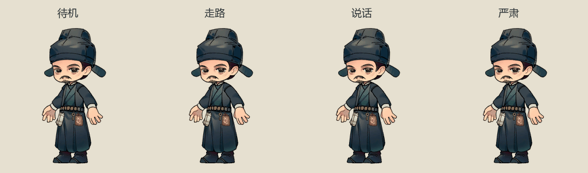
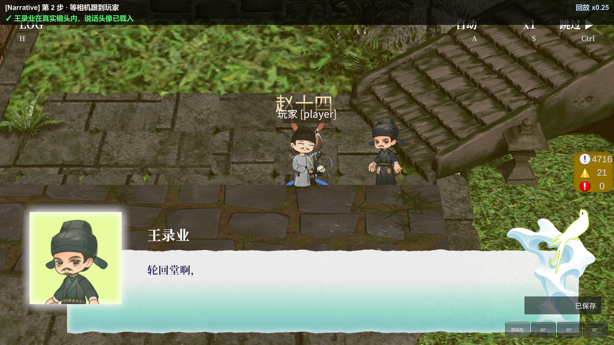

# 王录业动画与书库对白接入

本地制作日期：2026-10-19。来源沿用 [角色交付映射](feishu-asset-map.md) 的王录业包；本次不重新下载或发布素材。当前目录实查为15张512×512静态RGBA拆件，不是16张，也不是已交付动作序列。源PNG及其.meta保持不变。

## 制作与保留

- `Assets/_Project/Prefabs/Characters/Chibi_wang_luye_parts.prefab` 保存14层可见组装、两个可替换表情及关节。头／帽子共用头部父链，手臂在肩肘连接，饰品跟腰，脚在长袍下；原图完整画布不裁。
- 源标定Sprite在 `Assets/_Project/Art/Sprites/Characters/wang_luye/rig/`，关节剪辑在同名角色动画目录的 `rig/`。首次制作脚本发现现有标定预制体时拒绝覆盖。
- 采样真实Unity剪辑导出168张透明512×512整帧：Idle／talk／serious各48张，Walk24张；24fps。PPU320、脚底pivot(0.5,20/512)，朝左源图由生成器设置flipX。没有独立Run，沿用现有Walk回退。
- 最终资产：`Assets/_Project/Prefabs/Characters/Chibi_wang_luye.prefab`、`Assets/_Project/Art/Animations/Characters/wang_luye/chr_wang_luye*.anim` 与控制器；复用FramePuppetGenerator，未新增动画框架。
- 三张512×512透明半身头像从同一正确组装导出，默认与严肃图共用闭口造型，说话图使用交付的开口表情。地址为 `Dialogue/Portrait_wang_luye_{default,talk,serious}`，登记到现有UI地址组。

制作入口依次为 `Tools/build-wang-luye-animation.txt`、`Tools/bake-wang-luye-frames.txt`、`FramePuppetGenerator.Generate`；场景接线入口为 `Tools/bind-wang-luye-dialogue.txt`。帧重新导出保留已有.meta；首次组装不能直接重跑覆盖关节。

## 已有对白和演员生命周期

只绑定源表中已有的35句王录业台词：21007书库初会15句，21014名簿核对20句。角色ID为 `wang_luye`，名字仍为王录业；21007的r0164／r0166／r0169使用serious，其余32句talk。崔皓、旁白、案卷原文、跳转和剧情出口不变。表由Luban正常生成；文策导入器同步映射并有自检，避免再次导入丢头像。

采用用户确认的方式：对白期间在玩家身旁显示小人，头像进原框。SampleScene人界SpotlightStory的 `wangLuye` 引用 `WangLuyeDialogueFigure/Chibi_wang_luye`；初始隐藏，父容器带CameraBillboard，实例Motion停用。章节表现监听21007／21014会话开始，在当前镜头右侧布位，距离取SpotlightStoryConfig.DialogueActorDistance（本次1.5单位）；换句不重布位，Typing期间王录业选talk，显式严肃句选serious，换人或普通句打字完成回Idle。结束／取消／解绑收起人物；头像仍由原DialogueController与PortraitSlot加载、换人退场和释放。

书库沿用连续叙事，没有新增地点、任务、对白或玩法规则。当前正式入口只到21011之后，21014的服务播放验证不代表后续主线已完整实现。

## 验证记录

- 最终三模块EditMode：335通过、0失败、0跳过，批次 `5f6a341753fd4dc89b34cd043cb64487`；首次同范围335项也通过。
- Luban生成、文策导入自检、相关C# lint通过。透明帧数量／尺寸／RGBA透明角检查通过；GIF48帧自检通过。
- 定向运行回放首次发起过滤未发现用例，不计为通过。随后两次回放分别暴露验证脚本的跳过按钮、确认按钮加载时序，未到角色检查，已改用既有ClickWhenReady助手；失败报告保留在 `Logs/verify/narrative/20261019-185531/` 与 `20261019-185824/`。
- 最终运行回放：1通过、0失败、0跳过，批次 `da629d8a9c6f41c8a761d38cd9e62515`。报告 `Logs/verify/narrative/20261019-190654/report.md` 共40条记录、6张截图，检查点失败0、运行时异常0。前一通过批次为 `20261019-190152`；最终批次包含将站位距离移入现有SO后的复验。
- 验证内容：正常新局→李诏阳教学胜利→实际寻赵十四→21006→自动接21007；检查角色、正确姓名与头像、换人待机／头像退场、时停动画推进、严肃句表情，以及正常结束后的恢复。21014通过原DialogueService直接播放已有内容，再取消验证人物、头像、时间及正式阶段不串扰；不算完整后续路线验证。
- 最终演员引用、Motion停用、默认隐藏、SampleScene已恢复均实读确认。回放节奏恢复原值1。168帧及本次资产.meta配对齐全，15张源PNG及其.meta无diff；说话与严肃头像像素确实不同。
- 健康扫描最终通过。扫描期间曾报告运行中的InitTestScene与两份Dynamic字体缓存；回放退出后临时场景已自动清除，按项目字体规则通过Unity清缓存（Noto 6,404B，思源宋体6,329B），保留源字体与设置，控制台无错误。未改ProjectSettings；其现有三处未提交改动保留。

[严肃表情截图](wang-luye-20261019/dialogue-serious.png) · [21014原对白截图](wang-luye-20261019/dialogue-21014.png)

## 本次生成资产GUID

| 资产 | GUID |
| --- | --- |
| Chibi_wang_luye.prefab | acfaa2262042d914391b87e8852354df |
| Chibi_wang_luye_parts.prefab | 72acc2a263586714fb0af4adbff394de |
| chr_wang_luye.controller | 1e96815025f88f34a9990ac6f2335211 |
| Portrait_wang_luye_default.png | 7f69ad0753bba464486817997171704c |
| Portrait_wang_luye_talk.png | abf926a4203bd3949835528306eac79b |
| Portrait_wang_luye_serious.png | 5facd0b43a91cc74baefbabf5f4fb5f3 |

未做独立包、目标设备性能和完整后续主线；动作是按静态拆件制作的刚性关节序列，不是网格形变。审美与动作幅度请结合预览及真实镜头截图验收。
